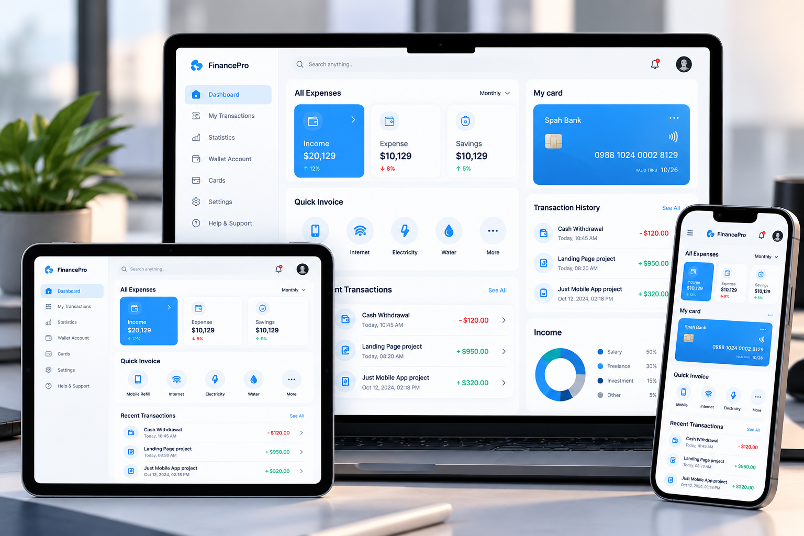

# 💳 Responsive Finance Dashboard

A modern and fully responsive finance dashboard designed for desktop, tablet, and mobile devices.

## 📸 Project Preview

## ✨ Features

- 📊 Income, expenses, and savings overview
- 💳 Bank card management UI
- 💰 Transaction history
- 📈 Financial statistics and analytics
- 🧾 Quick payment shortcuts
- 📱 Fully responsive design
- 🎨 Modern and clean user interface
- 💻 Desktop, tablet, and mobile support

## 📱 Responsive Design

The dashboard adapts seamlessly to different screen sizes:

- **Desktop:** Full dashboard with sidebar navigation
- **Tablet:** Optimized layout with compact components
- **Mobile:** Mobile-friendly interface with responsive cards

## 🎯 Project Objective

Build a professional finance dashboard interface that provides a smooth and consistent user experience across all devices.

## 👨‍💻 Developer

**Ahmed Jaber Ahmed**

- [GitHub](https://github.com/AhmedJaberAhmed)
- [LinkedIn](https://www.linkedin.com/in/ahmedjaberahmed/)
- [Portfolio](https://ahmedjaberahmed.github.io/Jaber-website/)

---

⭐ If you like this project, consider giving it a star!
